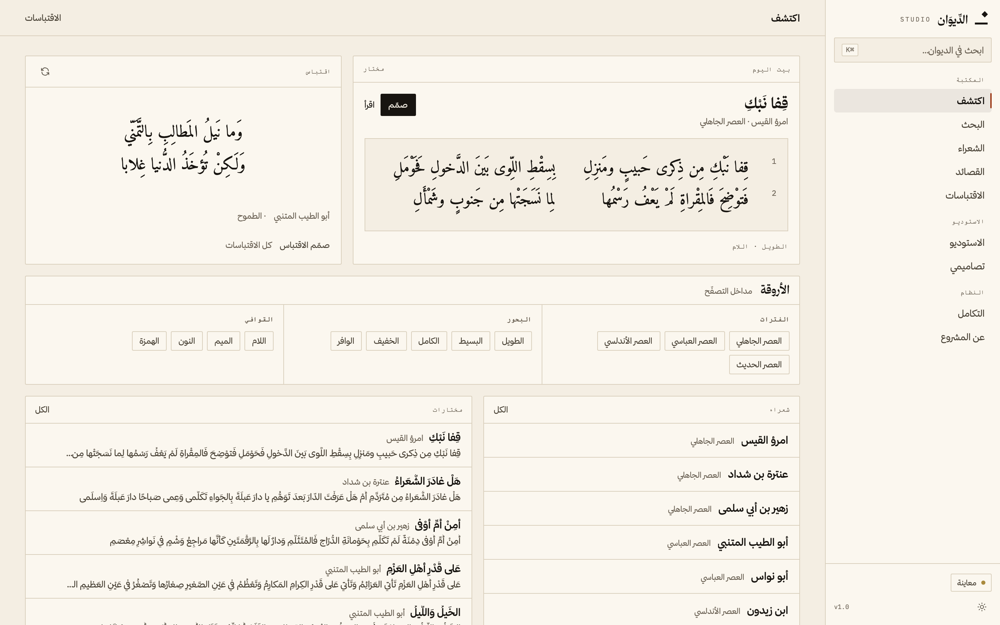
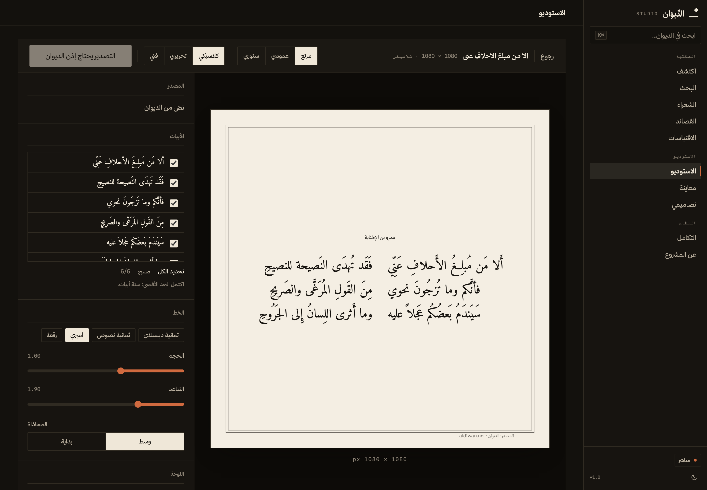
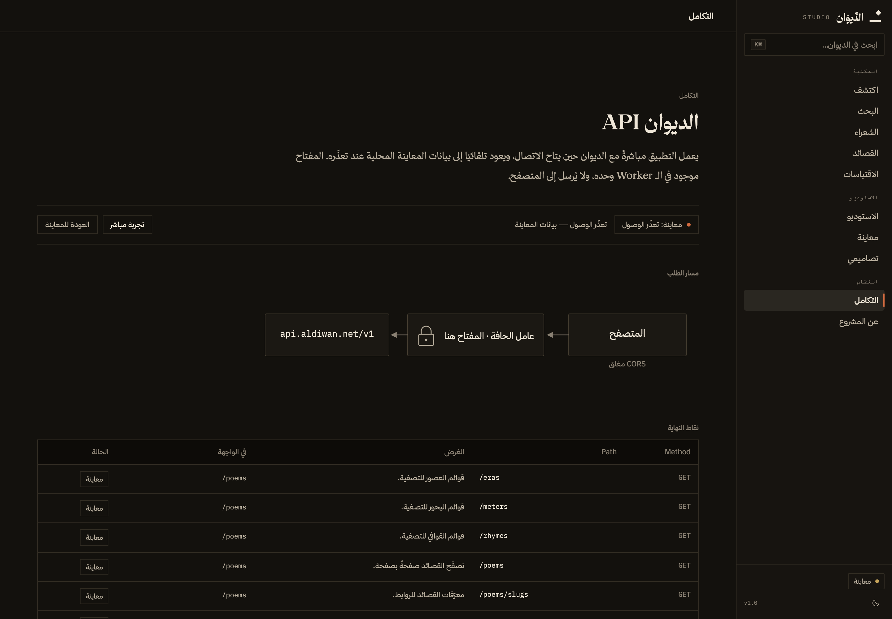

# Diwan Studio · ستوديو الديوان

[](LICENSE)
[](https://react.dev)
[](https://vite.dev)
[](https://www.typescriptlang.org)

**Discover classical Arabic poetry. Compose it. Export it.**

Diwan Studio is an independent, Arabic-first studio for reading classical Arabic poetry and turning it into typeset artwork. Discovery, poets, eras, meters, rhymes, quotations and full poems come from the AlDiwan API; the reader honours the API's `display_layout`; and the workbench turns selected verses into a print-ready composition with the source and attribution baked into the image.

**Live:** [diwan-studio.web.app](https://diwan-studio.web.app)

## Screenshots



<table>
  <tr>
    <td width="50%"></td>
    <td width="50%"></td>
  </tr>
  <tr>
    <td><em>Studio: pick verses, type, palette and frame.</em></td>
    <td><em>Integration: the proxy path, endpoint coverage and live quota.</em></td>
  </tr>
</table>

## How it works

| Piece | What it does |
|---|---|
| **Browser → Worker → API** | `api.aldiwan.net` sends no CORS headers, so live requests go to `/api/*` on a Cloudflare Worker. The Worker forwards to `https://api.aldiwan.net/v1/*`, attaches `ALDIWAN_API_KEY` server-side, caches GETs for 24 hours at the edge, and passes `X-Request-Id` and quota headers back. The key never reaches the browser. |
| **Demo fallback** | With no proxy configured, or when the live probe fails, the client switches to a bundled preview corpus of public-domain heritage texts. The UI labels the source; preview text is never presented as an AlDiwan response. |
| **Rights gate** | API text is displayed with the attribution AlDiwan returns, but export is controlled by `EXPORT_API_TEXT` in [`src/lib/rights.ts`](src/lib/rights.ts). It is `false`: API text stays display-only until AlDiwan grants written permission. Preview and user-supplied texts export freely. |

## Run it

```bash
git clone https://github.com/rrmanx/diwan-studio.git
cd diwan-studio
npm install
npm run dev        # http://localhost:5199
```

Node 22.12 or newer. The Thmanyah fonts are fetched from jsDelivr at dev and build time by `scripts/fetch-thmanyah.mjs`; they are not redistributed, and a network failure falls back to the bundled faces instead of failing the build.

### Environment

| Variable | Default | Purpose |
|---|---|---|
| `VITE_DATA_SOURCE` | _unset_ | `demo` forces the preview corpus; `live` forces the proxy; unset chooses live when `VITE_API_BASE` is set, otherwise demo. |
| `VITE_API_BASE` | `/api` | Proxy base URL, ending in `/api`. |
| `VITE_SITE_URL` | _unset_ | Canonical site URL used for links. |

Copy [`.env.example`](.env.example) to `.env.local` to get started.

```bash
npm run typecheck  # tsc --noEmit
npm run build      # typecheck + production build
```

## Deploy

**Hosting.** Build and deploy the static site to Firebase Hosting (project `rrmanx`, site `diwan-studio`):

```bash
npm run build
firebase deploy --only hosting --project rrmanx
```

`.env.production` is gitignored and must be created locally.

**Proxy.** The Worker lives in [`workers/aldiwan-proxy`](workers/aldiwan-proxy) and is the only server-side piece:

```bash
cd workers/aldiwan-proxy
npm install
npx wrangler login
npx wrangler secret put ALDIWAN_API_KEY
npm run deploy
```

Set `VITE_DATA_SOURCE=live` and point `VITE_API_BASE` at the deployed Worker.

## Credits

- **[AlDiwan API](https://developers.aldiwan.net)** — poetry discovery, poets, eras, meters, rhymes, quotations and poem texts, plus the endpoint contract this project is built against.
- **[Thmanyah fonts](https://font.thmanyah.com)** — Thmanyah Serif Display, Serif Text and Sans, used under the Thmanyah font licence and not redistributed in this repository.
- **[Amiri](https://github.com/aliftype/amiri)**, **[Aref Ruqaa](https://github.com/aliftype/aref-ruqaa)** and **[IBM Plex Mono](https://github.com/IBM/plex)** — artwork and interface faces under the SIL Open Font License.
- Built with [React](https://react.dev), [Vite](https://vite.dev), [TypeScript](https://www.typescriptlang.org) and [Tailwind CSS](https://tailwindcss.com).

## Notice

- Poetry texts remain the property of their sources. This project claims no ownership of poem, poet, quotation or metadata text returned by AlDiwan.
- The bundled preview corpus is public-domain classical Arabic heritage, included for offline evaluation and clearly labelled as preview data.
- The Thmanyah fonts are used under the Thmanyah licence and are not redistributed; `public/fonts/thmanyah/` is gitignored.
- The AlDiwan API is subject to AlDiwan's terms of use. Attribution is rendered wherever API text appears, API responses are cached for at most 24 hours, and API text is not archived, mirrored or bulk-exported.

## Not affiliated

Diwan Studio is an independent project. It is not affiliated with, endorsed by, or sponsored by AlDiwan or Thmanyah.

## License

MIT — see [LICENSE](LICENSE). Third-party text and fonts keep their own terms, as described in [Notice](#notice).

## Docs

- [docs/PLAN.md](docs/PLAN.md) — scope, IA, acceptance criteria
- [docs/DESIGN.md](docs/DESIGN.md) — identity, type, palette, components, motion
- [docs/API-MAP.md](docs/API-MAP.md) — endpoint → UI mapping, proxy contract
- [docs/RIGHTS.md](docs/RIGHTS.md) — attribution, caching, export permission
- [docs/LAUNCH.md](docs/LAUNCH.md) — positioning and launch notes
- [docs/brand/brand-sheet.png](docs/brand/brand-sheet.png) — identity sheet
