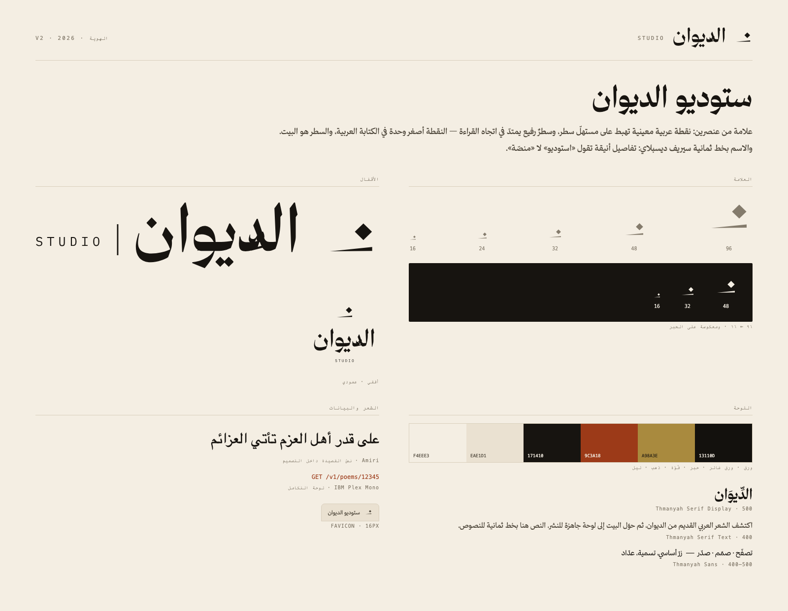

# Diwan Studio — ستوديو الديوان

**Discover classical Arabic poetry. Compose it. Export it.**

Diwan Studio is an independent, Arabic-first studio for reading classical Arabic poetry and turning
it into typeset artwork. It is built around the [AlDiwan developer API](https://developers.aldiwan.net)
— discovery, poets, eras, meters, rhymes, quotations and full poems all come from the API contract.

Live: **https://diwan-studio.web.app** · Owner: [rrmanx](https://github.com/rrmanx)



## What it does

| | |
|---|---|
| **Discover** | Search, poets, eras, meters, rhymes, quote of the moment |
| **Read** | Full poem view that honours the API's `display_layout` (hemistichs, lines, stanzas) |
| **Compose** | Three templates (Classical / Editorial / Artistic), type, palette, frame, verse picker |
| **Export** | PNG at 1080×1080, 1080×1350, 1080×1920, attribution baked in |
| **Inspect** | A request panel showing endpoint, status, latency, request-id and quota — never the key |

## Stack

React 19 · Vite · TypeScript · Tailwind v4 · hand-built SVG renderer · Firebase Hosting ·
Cloudflare Worker proxy (`workers/aldiwan-proxy`).

## Running it

```bash
npm install
npm run dev      # http://localhost:5199
npm run build    # typecheck + production build
```

### Data sources

The client speaks one typed contract with two providers:

```bash
# preview mode (default): 9 public-domain poems, 8 poets, 12 quotes bundled in src/data/demo
VITE_DATA_SOURCE=demo

# live mode: every call goes through the proxy; the key never reaches the browser
VITE_DATA_SOURCE=live
VITE_API_BASE=https://diwan-aldiwan-proxy.<account>.workers.dev/api
```

The preview corpus is classical heritage text (public domain), clearly labelled in the UI — it is
not an AlDiwan response and never claims to be one.

### Deploying

```bash
npm run build
firebase deploy --only hosting --project rrmanx   # site: diwan-studio
```

### The API proxy

`api.aldiwan.net` sends no CORS headers, so the browser cannot call it. The Worker is the only
server-side piece:

```bash
cd workers/aldiwan-proxy
npm install
npx wrangler login
npx wrangler secret put ALDIWAN_API_KEY
npm run deploy
```

It forwards `/api/*` → `https://api.aldiwan.net/v1/*`, caches GETs for 24 hours at the edge,
allow-lists origins, and passes through `X-Request-Id` and the quota headers.

## Rights

- AlDiwan attribution is rendered wherever API text appears and is baked into exports.
- API responses are cached for at most 24 hours, never archived.
- Exporting **API-sourced** text as social artwork needs written permission from AlDiwan;
  until then the export gate stays closed for live text (`src/lib/rights.ts`).
- Preview (public-domain) and user-supplied texts export freely.

See [docs/RIGHTS.md](docs/RIGHTS.md) and [docs/API-MAP.md](docs/API-MAP.md).

## Type

Identity, headlines and titles: **Thmanyah Serif Display** · body: **Thmanyah Serif Text** ·
interface: **Thmanyah Sans** (© Thmanyah, used under the Thmanyah font licence — files are fetched
at build time by `scripts/fetch-thmanyah.mjs` and are not redistributed in this repository).
Artwork faces: **Amiri** and **Aref Ruqaa** (SIL OFL). API panel: **IBM Plex Mono** (SIL OFL).

## Docs

- [docs/PLAN.md](docs/PLAN.md) — scope, IA, acceptance criteria
- [docs/DESIGN.md](docs/DESIGN.md) — identity, type, palette, components, motion
- [docs/API-MAP.md](docs/API-MAP.md) — endpoint → UI mapping, proxy contract
- [docs/RIGHTS.md](docs/RIGHTS.md) — attribution, caching, export permission
- [docs/brand/brand-sheet.png](docs/brand/brand-sheet.png) — identity sheet
